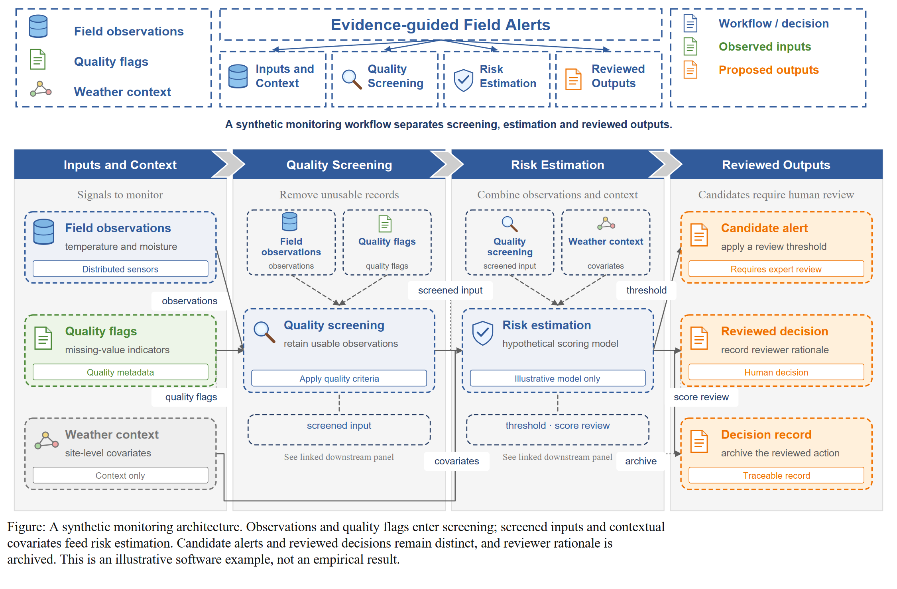
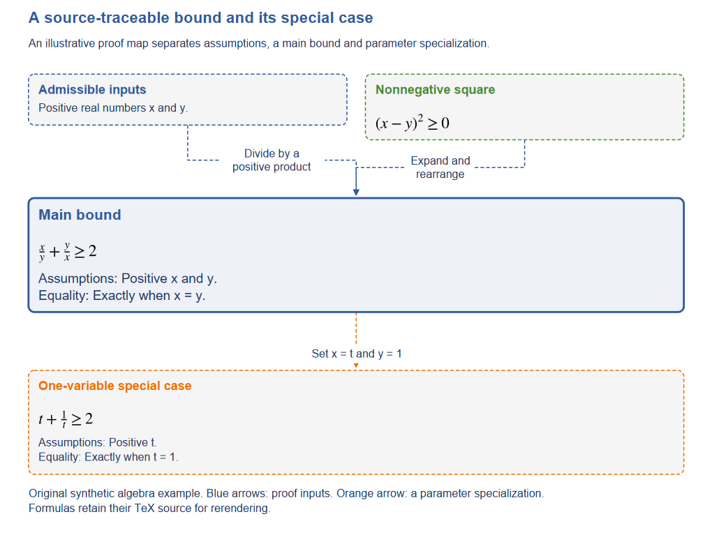
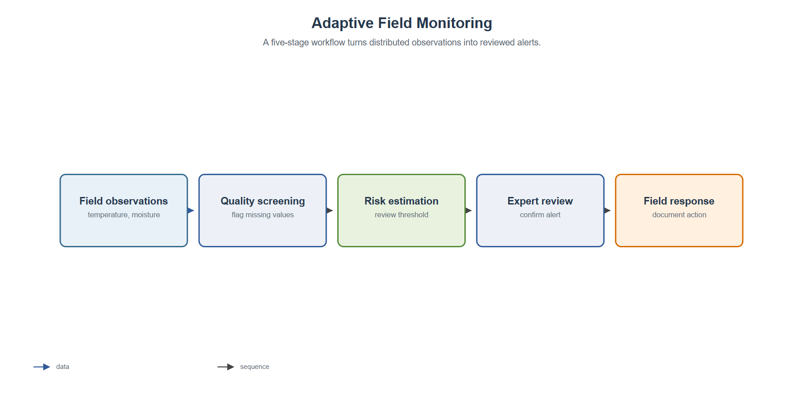
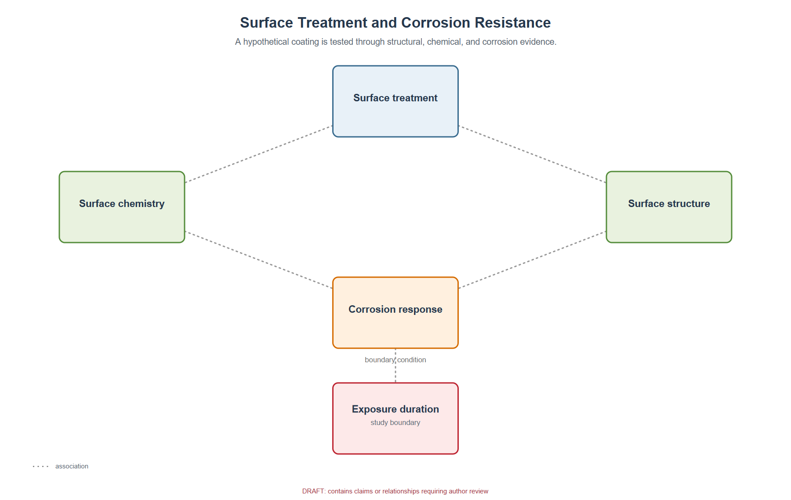
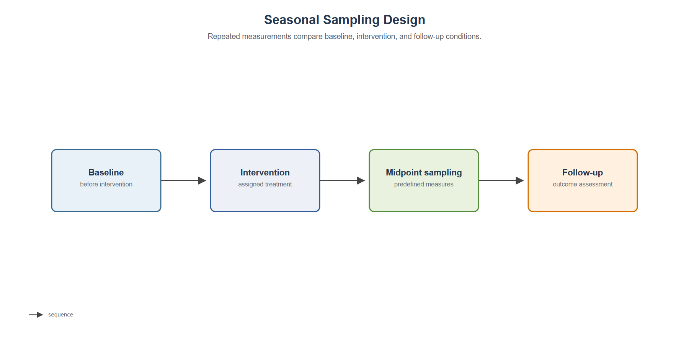
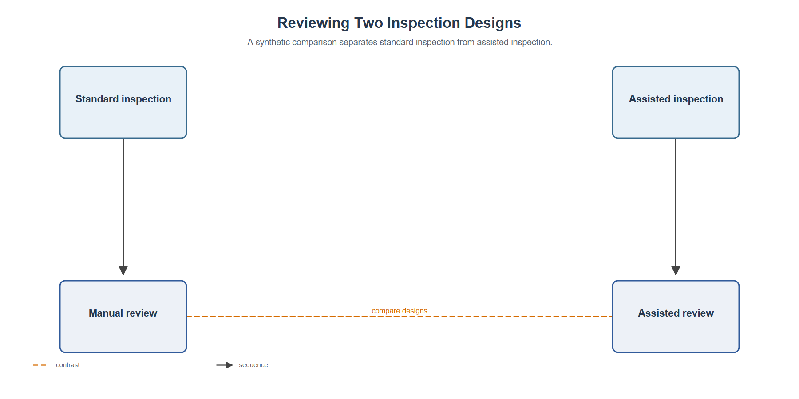
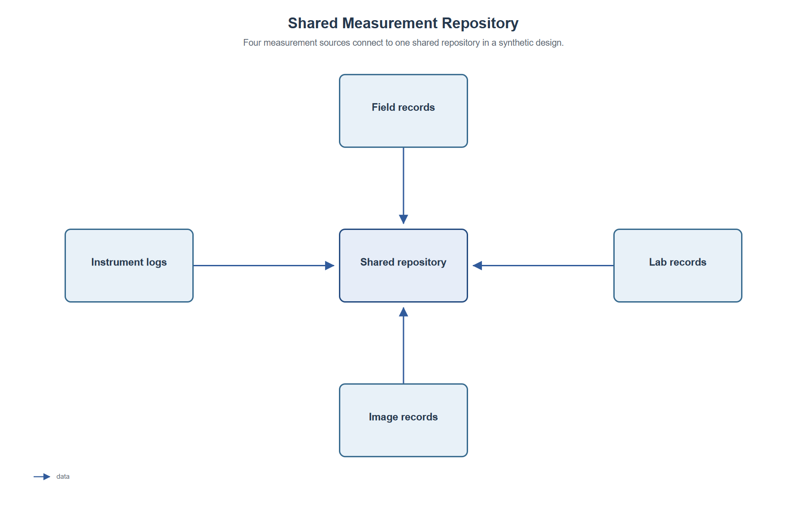
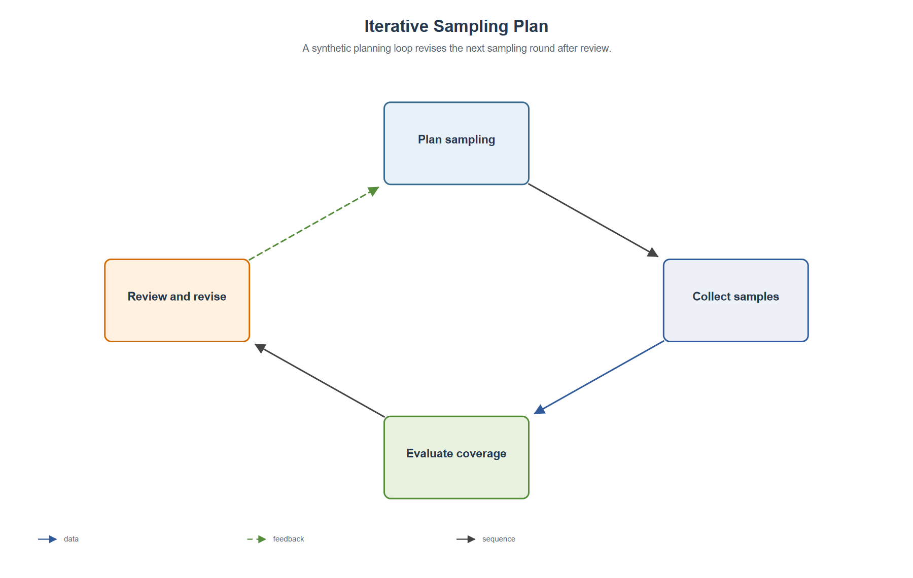

# PaperVisual — AI-Assisted Graphical Abstracts & Paper Summaries

中文说明：[README.zh-CN.md](README.zh-CN.md) · [GitHub 发布指南](docs/github-publish.zh-CN.md)

PaperVisual helps turn a research paper into a concise graphical abstract or visual overview, starting from a reviewed, source-grounded JSON brief. It recommends a layout from the declared relationships, renders native SVG text and shapes, and runs structural and geometry checks. Core non-math SVG works offline with no runtime dependencies; math and measured rendering audits use optional extras.

This is an early MVP. It does not parse manuscript files or independently verify scientific facts. Users provide a JSON brief or explicitly send selected text to a configured model endpoint to draft one; model-generated claims and relationships are review-required. This boundary is deliberate: unsupported causal or mechanistic links must not be presented as verified.

## Graphical abstracts & paper overviews

**The primary use case:** summarize a paper's research question, central method or proof, main result, and scope in **one editable figure**. Start with these two reproducible, synthetic examples rather than the minimal layout tests below.

### Featured — four-panel visual overview



**[View SVG](examples/rendered/reference.svg) · [Review input JSON](examples/reference.json) · [Reference design guide](docs/reference-style.zh-CN.md)**

This example demonstrates the **`reference`** theme: four-panel organization, a top-level claim, figure legend, concise links, and an embedded caption. Its subject matter is fictional; it is not an analyzed paper or a validated scientific claim.

### Featured — theoretical proof overview



**[View SVG](examples/rendered/theory.svg) · [Review input JSON](examples/theory/brief.json) · [Scientific checks](docs/scientific-qa.md)**

This illustrates a different, **`theory`** theme suitable for mathematical papers, with results and proof dependencies. Both featured figures require human scientific and visual review before any real-paper use.

To reproduce the four-panel figure locally:

```powershell
New-Item -ItemType Directory -Force work | Out-Null
papervisual render examples/reference.json -o work/reference.svg
```

To export on Windows without configuring native Cairo, open the SVG in Inkscape or run this command after installing Inkscape:

```powershell
& "C:\Program Files\Inkscape\bin\inkscape.exe" work\reference.svg --export-filename=work\reference.png --export-width=3000
```

Direct `--png` / `--pdf` export via CairoSVG requires the native Cairo library in addition to the Python package; Windows users without it can use Inkscape. The illustrative figures are *not* generated directly from PDF uploads: the rendering input is a reviewed JSON brief.

## What it does

PaperVisual is intended for **one-figure paper introductions**: clarify the research question, highlight the contribution, show the central method or proof structure, and summarize the key result and scope. It produces **editable SVG figure drafts**, not automatically certified publication-ready figures. The scientific claims and the final layout still require author review.

## Quick start

Requires Python 3.10 or newer.

Clone this repository first (`git clone https://github.com/KuoYuan-ame/papervisual.git`) and enter its directory (`cd papervisual`). The commands below use PowerShell. On macOS/Linux, activate the environment with `source .venv/bin/activate` and use `/` in paths.

```powershell
python -m venv .venv
.\.venv\Scripts\Activate.ps1
python -m pip install -e .
New-Item -ItemType Directory -Force work | Out-Null
papervisual init work\my-figure.json
papervisual validate examples\reference.json
papervisual render examples\reference.json --output work\reference.svg
papervisual qa examples\reference.json --svg work\reference.svg
papervisual suggest examples\mechanism.json
```

Open the SVG in a browser, Inkscape, Illustrator, or Figma. Labels remain text objects and shapes, arrows, and text can be edited separately. To create a PNG, export the SVG with a vector editor or browser at the desired resolution.

Batch rendering produces one SVG and QA report per JSON brief, plus a summary. Invalid briefs are reported without stopping the remaining work:

```sh
papervisual batch examples --output-dir work/batch --png --pdf
```

Optional direct PNG/PDF export uses CairoSVG:

```powershell
python -m pip install -e ".[raster]"
papervisual render examples\mechanism.json --output work\mechanism.svg --png work\mechanism.png --pdf work\mechanism.pdf
```

An optional model-assisted draft command supports OpenAI-compatible endpoints. It transmits the selected text outside the computer, so the command requires an explicit flag and a user-supplied model key:

```powershell
$env:PAPERFIG_API_KEY = "your-provider-key"
papervisual draft manuscript-excerpt.txt --model your-model --allow-external --language en --style reference --output work\draft.json
papervisual suggest work\draft.json
```

Use this only when you are allowed to share that text with the configured provider. The defaults are English figure text and the reference theme; pass `--language zh` only when Chinese output is requested. The extraction prompt builds a contribution and evidence chain rather than a table of contents. The generated claim, nodes, and edges are forcibly marked `needs_review`; inspect the content and source anchors before rendering. The local-only JSON workflow never sends network requests.

## Install as an agent skill

The agent skill entry point is [`skills/papervisual/SKILL.md`](skills/papervisual/SKILL.md). Copy the **whole** `skills/papervisual/` folder into your agent's skills directory, or install the matching standalone ZIP. Its exact installation location depends on your agent client. The Skill guides paper extraction and evidence checks; the bundled Python renderer handles the SVG output.

## Portable skill

Before release, run `python skills/papervisual/scripts/self_check.py --output-dir work/self-check` to check dependencies, manifest hashes, the four CLI steps and repeated SVG hashes in one JSON report. Add `--require-raster` when PNG/PDF export is required. Exit code 0 means automated success only: visual QA remains incomplete until an actual inspection. Without Cairo, inspect SVG at final dimensions in an available viewer; without a viewer, explicitly report human visual QA as incomplete.

Copy `skills/papervisual/` as a complete folder, or use the standalone skill ZIP. It includes the instructions, original PNG/SVG visual anchor, source-grounded synthesis workflow, schema and offline renderer. Run `python /absolute/path/to/scripts/papervisual.py` with normal CLI arguments; no repository installation is needed. Python 3.10+ suffices for non-math SVG; formulas additionally need Matplotlib; PNG/PDF additionally need CairoSVG and native Cairo. Fonts remain environment-dependent.

Maintainers run `python tools/bundle_skill.py --zip dist/papervisual-skill.zip` to sync resources from `src/` and `docs/` and generate a deterministic ZIP with SHA256. `--check` detects drift in CI. The source distribution includes the skill; the wheel provides the CLI only. See [the standalone test and handoff procedure](skills/papervisual/references/portable-test.zh-CN.md) for a new-chat prompt and the distinction between rendering replay and a fresh paper-analysis test.

## Project name and compatibility

**Public brand / GitHub repo / Skill ID / new CLI:** `PaperVisual` / `papervisual` / `papervisual` / `papervisual`. The underlying Python import package remains `paperfig`, and the older `paperfig` command and `scripts/paperfig.py` launcher remain available for compatibility. Optional model authentication continues to use `PAPERFIG_API_KEY` to avoid breaking existing setups.

## Workflow

1. Start from an example or author a JSON brief using `schemas/figure-ir.schema.json`.
2. Separate the paper's specific contribution from background, then select only the evidence and intermediate results needed to explain it. Record source anchors.
3. Distinguish proof dependency from specialization in theory papers, and association from causation in empirical work.
4. Use English for reader-facing text unless another language is requested. Run `papervisual suggest` and review the recommended archetype and reasons.
5. Run `papervisual validate`, then render to SVG.
6. Run `papervisual qa` and review the author checklist in the report.
7. Edit the JSON and rerender until the scientific story and layout are correct.

Available archetypes: `pipeline`, `compare`, `hub_spoke`, `timeline`, `mechanism`, and `loop`. The recommendation is a transparent heuristic; set `archetype` explicitly to override it.

The JSON `language` field records the intended text language (`en` by default or `zh`). It is metadata for review; the renderer preserves supplied wording and does not translate manually authored briefs. `papervisual draft` chooses English unless `--language zh` is explicitly supplied.

For a compact paper overview with blue header bands, dashed groups, original vector icons, and a manuscript caption, set `style: "reference"`, assign each node to one of 2–4 `panel` groups, and provide concise `panel_labels`. Use `panel_descriptors` to replace or hide generic subheadings and `legend_labels` to match visible role colors to the paper. `caption` and short source-backed node `annotations` are optional. Start with [the synthetic reference example](examples/reference.json); see the [style guide](docs/reference-style.zh-CN.md). This theme uses declared panel groups instead of the recommended archetype. Chinese export requires a suitable installed font and visual inspection on the target machine.

## Scientific release checks

Supply `claim_source` and sources for every node and edge. `validate --release` blocks missing evidence locators; `qa --require-confirmed` separately requires declared author review. A locator is not independent source verification.

For a proof-centered paper use `style: "theory"`, exactly one `emphasis: "main"` node, and separate `formula`, `assumptions` and `equality` fields. Mathtext renders fractions and scripts as vector paths, preserving TeX for rerendering; ordinary labels remain editable text. See the [synthetic theory brief](examples/theory/brief.json) and [scientific contracts](docs/scientific-qa.md).

Set `width_mm`, `min_font_pt` and `dpi` before rendering. The theory layout reflows at that width; QA flags undersized text in other layouts. Diagnose dependencies first, then measure glyph coverage, actual text bounds, label collisions and polyline crossings:

```sh
python -m pip install ".[audit]"
papervisual doctor --output work/doctor.json
papervisual render examples/theory/brief.json -o work/theory.svg --png work/theory.png --pdf work/theory.pdf
papervisual qa examples/theory/brief.json --svg work/theory.svg --release --rendered
python skills/papervisual/scripts/self_check.py --output-dir work/release-check --release --rendered --require-raster
```

Reports separate structural, source, rendering, author declaration and visual states. Rendering checks have documented limits; human visual QA never becomes completed merely by running a command. Core SVG-only checks remain available without optional dependencies.

## Additional layout archetypes

The following compact diagrams demonstrate six *optional layout archetypes*. They are not the main graphical-abstract showcase. All briefs are synthetic and use original shapes; see [evaluation scope](docs/evaluation.md).

| Pipeline | Mechanism / hub-spoke | Timeline |
|---|---|---|
|  |  |  |

| Compare | Hub-spoke | Loop |
|---|---|---|
|  |  |  |

## Commands

```text
papervisual init [path]                 Write a starter brief
papervisual draft TEXT --model MODEL    Opt-in text-to-draft extraction (requires --allow-external)
papervisual suggest BRIEF.json          Recommend a layout and explain why
papervisual validate BRIEF.json         Check required fields and graph structure
papervisual render BRIEF.json -o out.svg Render an editable SVG
papervisual batch DIRECTORY -o figures [--png] [--pdf] Render a directory of reviewed JSON briefs
papervisual qa BRIEF.json --svg out.svg Check structure and approximate text bounds
```

## Input model

The brief is a JSON graph. Each node has a stable `id`, visible `label`, and semantic `role`. Each edge records `from`, `to`, a `relation` type, and a source anchor and review status (missing status defaults to `needs_review`). Relations include `sequence`, `data`, `causal`, `feedback`, `contrast`, `association`, `hierarchy`, `proof_dependency`, and `specialization`.

Use `review_status: "needs_review"` for interpretations not directly established by the source. The tool flags these so they are not silently presented as verified. Colors encode node roles, not truth or evidence strength.

## Scientific review and limitations

- The author remains responsible for claim accuracy, arrow meaning, terminology, and journal policy.
- A layout recommendation is not evidence that the paper supports the depicted relationships.
- Text fitting uses a conservative character-width estimate. Always inspect the exported SVG at its intended print size.
- Manuscript-file parsing, visual editing UI, and journal-specific checks are not included in this MVP. Model-assisted text drafting and optional CairoSVG export are described above.
- The optional model adapter transmits selected text to the configured endpoint. Review [the privacy notes](docs/privacy.md) and provider terms before use.

## Development

```powershell
python -m unittest discover -s tests -v
```

See [the workflow guide](docs/workflow.md), [the reusable PaperVisual skill](skills/papervisual/SKILL.md), [a Chinese conversation handoff](docs/agent-workflow.zh-CN.md), [the IR reference](docs/figure-ir.md), [privacy notes](docs/privacy.md), [ROADMAP.md](ROADMAP.md), [CONTRIBUTING.md](CONTRIBUTING.md), [SECURITY.md](SECURITY.md), and [CHANGELOG.md](CHANGELOG.md). Examples are original synthetic examples and are not copied from a paper.

## License

Code is licensed under the MIT License. Example briefs are synthetic and may be reused under the same license. Third-party assets are not bundled.
