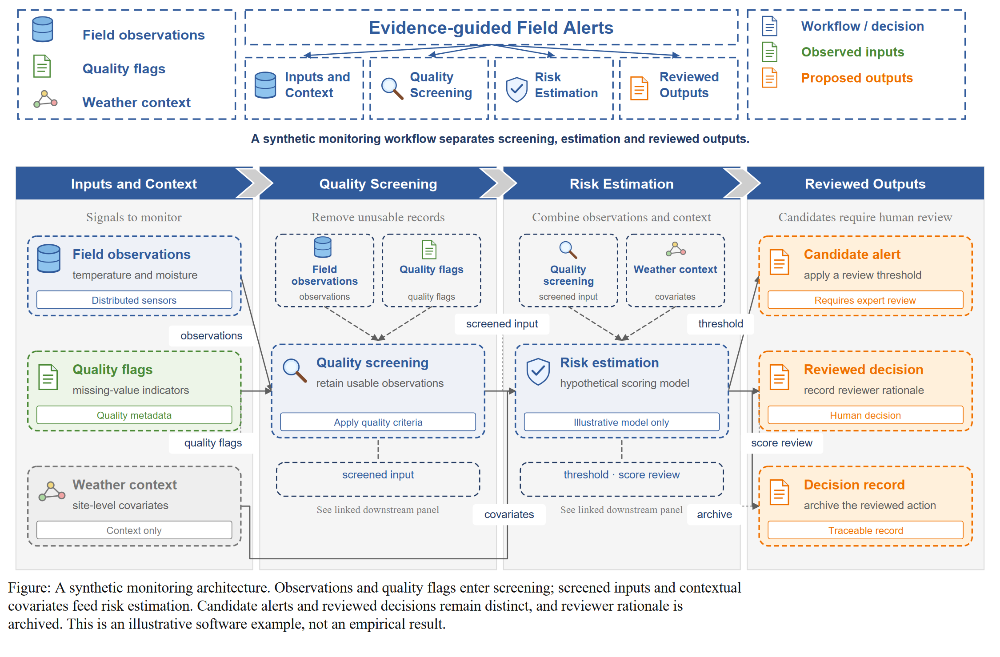
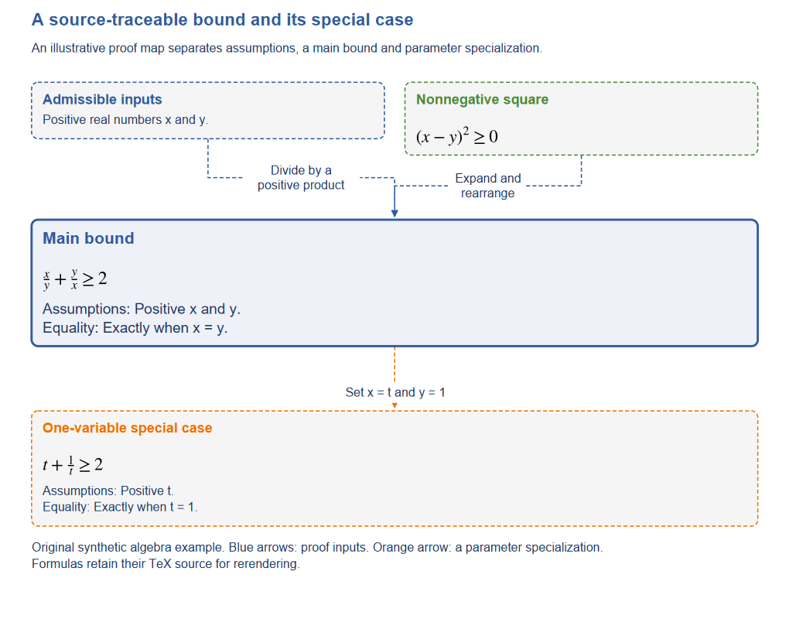
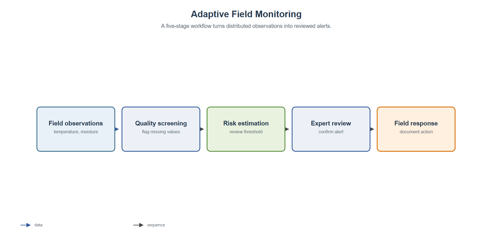
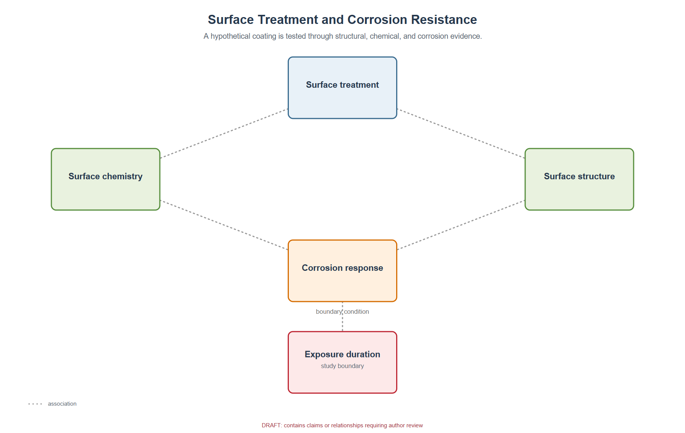
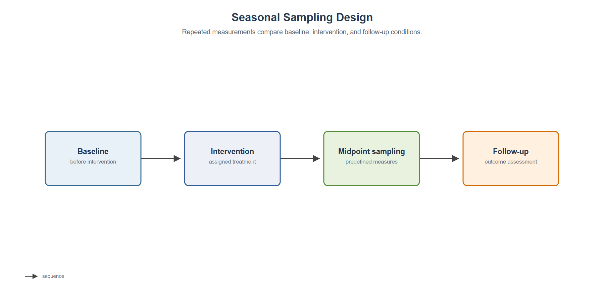
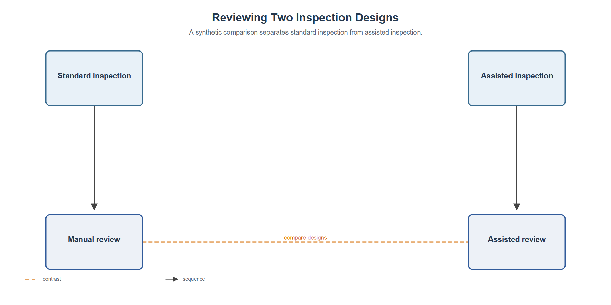
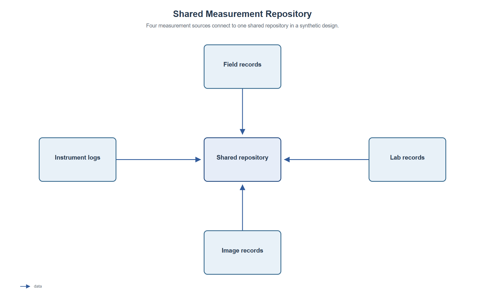
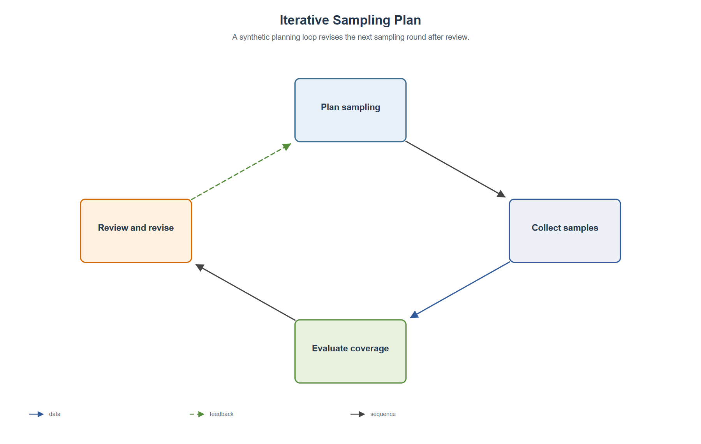

# PaperVisual — 论文图形摘要与简介图生成工具

**让一张图快速介绍论文：把研究问题、核心方法、主要贡献和结论整理成可审查、可编辑的 SVG 简介图。** 输入经过作者核对的 JSON 图稿，工具会给出可解释的布局建议、渲染原生 SVG，并检查图结构和部分几何问题。非公式 SVG 核心流程完全离线运行，无必需运行时依赖；数学排版和测量验收使用可选依赖。

[English](README.md) · [工作流](docs/workflow.md) · [图稿数据格式](docs/figure-ir.md) · [隐私说明](docs/privacy.md)

> 这是一个早期 MVP。它不会读取 PDF/DOCX，也不能独立验证论文内容。可选的模型辅助命令仅生成待作者审阅的草稿；不应把它当作自动理解论文或直接生成可投稿成图的系统。

## 核心展示：一图读懂论文

PaperVisual 的主场景不是简单流程图，而是把论文的**研究问题、关键方法或证明结构、主要结论以及适用范围**整理成一张可编辑的简介图。以下两张图来自仓库已有的**原创合成 JSON 示例**，可直接重新渲染；不是对真实论文的自动分析结果。

### 示例一：横向四栏科研简介图（Reference）



[查看 SVG](examples/rendered/reference.svg) · [查看可复现 JSON](examples/reference.json) · [风格与适配说明](docs/reference-style.zh-CN.md)

这种布局最接近我们希望主推的图形摘要风格：深蓝标题带、顶部研究概览、按论文逻辑组织的栏目、证据与结果的区分，以及底部完整图注。

### 示例二：理论论文的证明结构图（Theory）



[查看 SVG](examples/rendered/theory.svg) · [查看可复现 JSON](examples/theory/brief.json) · [科学性与数学排版检查](docs/scientific-qa.md)

该示例说明同一个工具也可以用于理论论文，强调前提、主结果、证明依赖与特殊情形。样例内容为合成数据，不能替代对论文论断和证明箭头的作者审核。

**在 Windows 上快速复现主展示图：**

```powershell
New-Item -ItemType Directory -Force work | Out-Null
papervisual render examples/reference.json -o work/reference.svg
```

已经安装 Inkscape 的 Windows 用户，可以额外导出高分辨率 PNG：

```powershell
& "C:\Program Files\Inkscape\bin\inkscape.exe" work\reference.svg --export-filename=work\reference.png --export-width=3000
```

内置 `--png`、`--pdf` 依赖 CairoSVG **和系统原生 Cairo DLL**，仅安装 Python 包仍可能无法在 Windows 上导出。建议以 SVG 为可编辑母版，在 Inkscape 中转换为图片或 PDF。

## 项目定位

PaperVisual 主要用于制作论文的**图形摘要（Graphical Abstract）**、一图概览（Paper Overview）与研究框架简介图。当前流程是先根据论文提炼并人工核对 JSON 图稿，再由工具生成可编辑 SVG；并不支持直接读取 PDF 全自动出图，也不能保证无须人工排版就可投稿。

## 快速开始

需要 Python 3.10 或更新版本：

```powershell
git clone https://github.com/KuoYuan-ame/papervisual.git
cd papervisual
python -m venv .venv
.\.venv\Scripts\Activate.ps1
python -m pip install -e .
New-Item -ItemType Directory -Force work | Out-Null
papervisual validate examples\reference.json
papervisual render examples\reference.json --output work\reference.svg
papervisual qa examples\reference.json --svg work\reference.svg
papervisual suggest examples\pipeline.json
```

SVG 中的文字、框和箭头均为可编辑矢量对象，可用 Inkscape、Illustrator、Figma 或浏览器打开。安装可选导出依赖后，也可从同一 SVG 生成 PNG/PDF：

```powershell
python -m pip install -e ".[raster]"
papervisual render examples\pipeline.json --output work\pipeline.svg --png work\pipeline.png --pdf work\pipeline.pdf
```

批量处理目录下所有 JSON 图稿，并为每张图保存 SVG、QA 报告和汇总表：

```powershell
papervisual batch examples --output-dir work\batch --png --pdf
```

新对话可直接使用仓库内的[PaperVisual Skill](skills/papervisual/SKILL.md)或[中文制作流程](docs/agent-workflow.zh-CN.md)，按照“论文贡献—决定性证据—推导/比较—结论边界”提炼主线，再生成图稿。综述按分类与综合框架组织，不强行画成实验流程。理论论文可分别标记证明依赖 `proof_dependency` 与特殊化 `specialization`。图中未指定语言时默认用英文；外部模型草稿命令默认 `--language en --style reference`，明确要求中文时再传 `--language zh`。

## Agent Skill 安装

Skill 入口在 [`skills/papervisual/SKILL.md`](skills/papervisual/SKILL.md)，需要复制 **整个** `skills/papervisual/` 文件夹，而不是只复制 `SKILL.md`。安装到 Codex 时，可以使用其 Skill 安装器并指定 GitHub 仓库中 `skills/papervisual` 目录。请以你的 Codex 版本支持的安装方式为准。

## 可独立安装的 Skill 包

发布前可运行 `python skills/papervisual/scripts/self_check.py --output-dir work/self-check`：统一核对依赖、manifest、四个 CLI 步骤及重复 SVG 哈希，输出 `self-check.json`。需要 PNG/PDF 时加 `--require-raster`。返回成功只表示自动检查通过；人工视觉检查另行完成。缺少 Cairo 时使用 SVG 查看器按最终尺寸检查，查看器也不可用时明确记录“人工视觉 QA 未完成”。

`skills/papervisual/` 包含完整的 Skill 指令、原创视觉样例、内容提炼与风格规范、Schema 和离线渲染程序，可单独复制到技能目录或交给新对话。入口为 `python /实际路径/scripts/papervisual.py`，不依赖仓库内的相对路径，也无需先安装本项目。SVG 只需 Python 3.10+；PNG/PDF 还需 CairoSVG 和系统 Cairo。

开发时以 `src/paperfig/` 和 `docs/` 为维护源；运行 `python tools/bundle_skill.py --zip dist/papervisual-skill.zip` 同步资源并生成可复验 ZIP 与 SHA256。`python tools/bundle_skill.py --check` 检测资源漂移，CI 也执行此检查。源码包包含 Skill；wheel 只提供 Python CLI，单独安装 Skill 应使用 ZIP 或仓库内文件夹。详见[独立测试及新对话入口](skills/papervisual/references/portable-test.zh-CN.md)。

## 附加功能：六种基础布局

下列六种布局用于展示渲染器的其他能力，**并非项目首页的主打论文简介图**。示例内容均为原创虚构素材，并非真实论文或实证结论。

| 流程图 | 分层机制布局 | 时间线 |
|---|---|---|
|  |  |  |

| 对照 | 中心分支 | 闭环 |
|---|---|---|
|  |  |  |

节点颜色表示图稿中的语义角色；箭头样式表示关系类别。颜色和连线不能代替图注中的说明。

主打的横向分栏 Reference 示例及其可复现 JSON 已置于页面开头，详见 [Reference 风格说明](docs/reference-style.zh-CN.md)。请勿把合成示例当作真实论文的研究结论；本仓库没有附带第三方论文截图。

## 生成流程

1. 从示例复制 JSON 图稿，写下一句图级主张，只保留解释该主张必要的节点。
2. 为关系选择顺序、数据、因果、反馈、对照、关联或层级，并尽可能添加论文来源锚点。
3. 运行 `papervisual suggest`，检查推荐理由；需要时在 `archetype` 字段显式指定布局。
4. 运行 `validate`、`render` 和 `qa`，人工检查每项科学内容以及最终尺寸下的版面。

支持 `pipeline`、`compare`、`hub_spoke`、`timeline`、`mechanism` 和 `loop` 六种起始布局。需要参考样品中横向分栏、深蓝标题带、虚线分组和图注的视觉风格时，可在 JSON 根对象设置 `"style": "reference"`，并为每个节点指定 `panel` 分组；再用 `panel_descriptors` 与 `legend_labels` 将固定主题文案适配论文语义。启发式规则可能选错；综述章节顺序不等于因果或研究流程，需检查并显式覆写建议。

## 可选模型草稿

只有获得授权且允许向相应服务发送文本时才使用。该命令会把所选文本发送到指定的 OpenAI 兼容端点；必须显式加 `--allow-external`，API 密钥从 `PAPERFIG_API_KEY` 环境变量读取：

```powershell
$env:PAPERFIG_API_KEY = "your-provider-key"
papervisual draft manuscript-excerpt.txt --model your-model --allow-external --output work\draft.json
```

该功能不是本地全文解析器。模型提出的主张、节点和关系均会标为 `needs_review`，仍须作者逐项核对。详见[隐私说明](docs/privacy.md)。

## 已知边界

- 不支持 PDF/DOCX 导入、OCR 或页面/段落定位。
- 不会独立检查来源片段是否支持图稿中的论断。
- 布局和文字尺寸估算仍有限；复杂或密集图稿可能需要手动修改 JSON 和 SVG。
- 自动检查通过不等于科学审核通过；最终图稿须由作者检查术语、证据、关系方向、限制项、字体和可读性。

## 命名与兼容性

对外统一为 **PaperVisual**，GitHub 仓库名、Skill ID 和新命令统一采用 `papervisual`。底层 Python 模块仍为 `paperfig`，旧的 `paperfig` 命令与 `scripts/paperfig.py` 启动器仍可运行；`PAPERFIG_API_KEY` 环境变量暂不改名，以兼容旧脚本。

详细步骤见[GitHub 上传与发布指南](docs/github-publish.zh-CN.md)。

## 开发与许可

```powershell
python -m unittest discover -s tests -v
```

详见[路线图](ROADMAP.md)、[贡献指南](CONTRIBUTING.md)、[安全说明](SECURITY.md)和[变更记录](CHANGELOG.md)。代码和原创虚构示例以 MIT 许可发布；项目不包含用户提供的参考截图或第三方图标。


## 科学信息、数学排版与发布检查

来源字段必须包括图级 `claim_source`、每个节点和边的 `source`。缺少审核状态默认 `needs_review`；`validate --release` 阻止缺少来源，`qa --require-confirmed` 独立要求作者声明。来源存在不等于科学解释正确。

理论论文可设 `style: "theory"`，用唯一 `emphasis: "main"` 突出主定理，用 `formula` 保存 TeX 数学表达式，`assumptions`、`equality` 保存附近的条件说明。公式使用 Mathtext/STIX 排成矢量路径，保留 TeX 以便改源重绘；普通标签仍是可编辑文本。过长公式要求调整布局或内容，不任意断行缩小。

先运行 `papervisual doctor`。设置 `width_mm`、`min_font_pt`、`dpi`，从最终尺寸开始排版。安装 `.[audit]` 后，使用 `qa --svg figure.svg --release --rendered` 检查缺字、实际文字边界、碰撞与穿节点连线。统一自检支持 `--release --rendered --require-raster`，但不会自动完成人工看图。详见 [科学验收与数学字段](docs/scientific-qa.md) 和 [原创理论示例](examples/theory/brief.json)。
